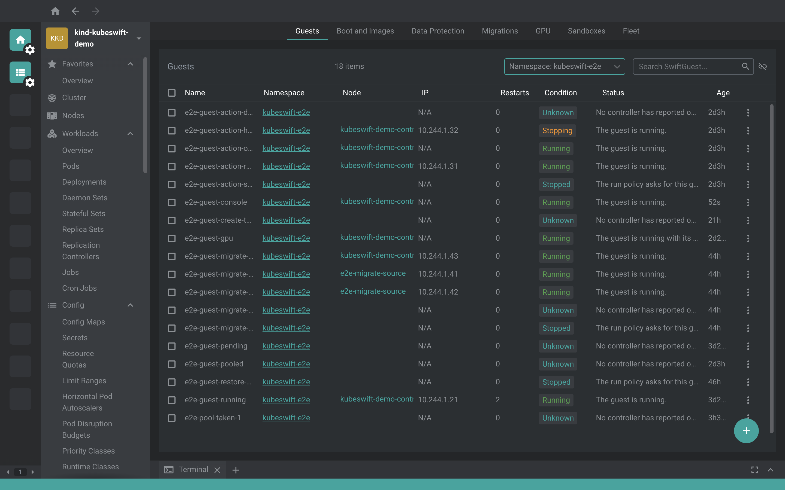

# @freelensapp/kubeswift-extension

[](https://freelens.app)
[](https://github.com/freelensapp/freelens-kubeswift-extension)
[](https://deepwiki.com/freelensapp/freelens-kubeswift-extension)
[](https://github.com/freelensapp/freelens-kubeswift-extension/releases)
[](https://github.com/freelensapp/freelens-kubeswift-extension/actions/workflows/unit-tests.yaml)
[](https://github.com/freelensapp/freelens-kubeswift-extension/actions/workflows/integration-tests.yaml)
[](https://www.npmjs.com/package/@freelensapp/kubeswift-extension)

## Overview

[Freelens](https://freelens.app) extension for
[KubeSwift](https://github.com/kubeswift-io/kubeswift), the Kubernetes-native
virtual machine runtime.

The extension covers every KubeSwift custom resource — all 19 kinds across 10
API groups — with list pages, detail drawers, lifecycle actions, creation
forms, and consoles, grouped in the cluster sidebar under **Guests**, **Boot
and Images**, **Data Protection**, **Migrations**, **GPU**, **Sandboxes**,
and **Fleet**.

[Video Demo](https://github.com/user-attachments/assets/4172ce40-7c07-41b9-bf78-f348ada18fa7)



The extension is CRD-native: it reads and writes the resources directly
through the Kubernetes API of the cluster you are connected to, with no
dependency on the KubeSwift UI gateway. It is also a from-scratch
implementation: the KubeSwift repositories are AGPL-3.0 and are used only as
a visual and domain reference, while every view here is MIT and reimplements
the behavior against the published CRD schemas (see
[ARCHITECTURE.md](docs/development/ARCHITECTURE.md) for the licensing
boundary).

## Requirements

- **Freelens >= 2.0.0.** Versions 0.x of the extension are for Freelens 1.x.
- **Kubernetes >= 1.24.**
- **KubeSwift v0.18.x.** The views track the v0.18.0 CRDs. The upstream API
  is `v1alpha1` and may change between KubeSwift releases; the extension
  follows.
- **Node.js** is required only when building the extension from source; it
  is not needed to run it.

## Supported APIs

All resources are `v1alpha1`.

| API group                | Kinds                                                                                   |
| ------------------------ | --------------------------------------------------------------------------------------- |
| `swift.kubeswift.io`     | SwiftGuest, SwiftGuestClass, SwiftGuestPool                                             |
| `image.kubeswift.io`     | SwiftImage                                                                              |
| `seed.kubeswift.io`      | SwiftSeedProfile                                                                        |
| `kernel.kubeswift.io`    | SwiftKernel                                                                             |
| `gpu.kubeswift.io`       | SwiftGPUProfile, SwiftGPUNode                                                           |
| `snapshot.kubeswift.io`  | SwiftSnapshot, SwiftRestore, SwiftSnapshotSchedule                                      |
| `migration.kubeswift.io` | SwiftMigration                                                                          |
| `sandbox.kubeswift.io`   | SwiftSandbox, SwiftSandboxPool, SwiftArtifactPlacement, SwiftArtifactVerificationPolicy |
| `storage.kubeswift.io`   | SwiftStorageLocation, SwiftClusterStorageLocation                                       |
| `fleet.kubeswift.io`     | Cluster                                                                                 |

## Install

Open Freelens and go to Extensions (`ctrl`+`shift`+`E` or
`cmd`+`shift`+`E`). The field at the top takes a package name, the URL of a
tarball, or the path to a tarball or a directory.

### From the registry

Enter `@freelensapp/kubeswift-extension` and press Install.

Alternatively, open the following URL in the browser to install directly:

[freelens://app/extensions/install/%40freelensapp%2Fkubeswift-extension](freelens://app/extensions/install/%40freelensapp%2Fkubeswift-extension)

### From a release tarball

Each [release](https://github.com/freelensapp/freelens-kubeswift-extension/releases)
has the extension as `freelensapp-kubeswift-extension-<version>.tgz`, with its
checksum in `freelensapp-kubeswift-extension-<version>.tgz.sha256`. Releases
1.0.0 and later are for Freelens 2.x, and 0.x releases for Freelens 1.x.

- Enter the URL of the `.tgz` asset and press Install. Freelens downloads the
  `.tgz.sha256` next to it and checks the tarball against it.
- Or download both files into one directory and enter the path to the `.tgz`,
  or drop the `.tgz` on the Freelens window. Freelens checks it against the
  `.tgz.sha256` next to it.

### From a directory

Build the extension (see below), then enter the path to your checkout, the
directory with `package.json`, and press Install. Freelens runs the extension
from that directory, from the files in `dist/`, and lists it as unverified.
This is how you work on the extension: see
[Development loop](#development-loop).

## Getting started

1. Connect to a cluster where KubeSwift is installed. The KubeSwift entry
   appears in the cluster sidebar.
2. Check the namespace filter: KubeSwift resources live in their own
   namespaces, and a freshly connected Freelens shows only `default`.
3. No KubeSwift cluster at hand? One command spins up a local demo cluster
   with realistic simulated fixtures, no KVM needed — see
   [TRY-IT.md](docs/development/TRY-IT.md).

## Features

### Views

Every kind gets a list page and a detail drawer: sortable and searchable
columns, phase and condition badges with consistent status semantics,
cross-links between related objects (guest to node, pod, class, snapshot,
GPU profile, and so on), and full support for both Freelens themes.

### Guest lifecycle

Start and Stop live in the row kebab and in the drawer toolbar. Nothing
happens on a single click: every action opens a dialog that lists the exact
API calls it is about to make, and cancelling writes nothing. Disabled
actions state their reason, and a stop that only half-succeeds tells you
what did and did not happen.

### Data protection

Take Snapshot (with its four storage backends), Restore (in place or as a
clone), snapshot schedules, and delete dialogs that read back what will
actually happen to the data before you confirm. Each snapshot names the
storage location it resolved, and the namespaced and cluster-wide storage
locations themselves have read-only views of their own.

### Migrations

Start Migration with a node picker, a prediction of the effective mode, and
a client-side guard against the auto-to-live trap on `ReadWriteOnce`
storage, where a live migration would put two pods on the same volume.

### Creation forms

Create dialogs for guests (image, kernel, or clone boot, with data disks,
network and port exposure, and GPU sections), guest classes, images,
kernels, seed profiles, guest pools (with the full guest template embedded),
sandboxes, and sandbox pools. Forms validate against the CRD rules as you
type, send explicit payloads, and never overwrite an existing object on a
name clash.

### Consoles

The VM serial console opens in a Freelens terminal tab. A sandbox exposes a
read-only console tail (the hypervisor writes a sandbox's serial line to a
file by construction). An interactive shell inside a sandbox microVM is
deliberately not offered: that channel is the guest agent's vsock protocol,
which belongs to the upstream AGPL gateway — use `swiftctl sandbox attach`
from a terminal instead.

## Limits

- Statuses come from the KubeSwift controllers. On a cluster without them
  (such as the local demo cluster) statuses are simulated and frozen.
- Behavior against real KVM-backed virtual machines has a manual test track
  of its own; see [TESTING.md](docs/development/TESTING.md).
- On Windows the serial console and the workload console do not connect
  yet: PowerShell, the default shell of the Freelens terminal there, breaks
  their command line
  ([#144](https://github.com/freelensapp/freelens-kubeswift-extension/issues/144)).

## Development

The repository is developed spec-first, with the specs in the repository:

- [ROADMAP.md](docs/development/ROADMAP.md) — the milestones toward v1.0.0
- [PROCESS.md](docs/development/PROCESS.md) — the spec-driven workflow
- [ARCHITECTURE.md](docs/development/ARCHITECTURE.md) — CRD-native design
  and the licensing boundary
- [DESIGN.md](docs/development/DESIGN.md) — the UI and UX directives
- [TESTING.md](docs/development/TESTING.md) — the test layers every feature
  ships with
- [TRY-IT.md](docs/development/TRY-IT.md) — the local demo cluster for
  manual testing
- [docs/specs/](docs/specs/) — one spec per feature

## Build from the source

### Prerequisites

Use [NVM](https://github.com/nvm-sh/nvm),
[mise-en-place](https://mise.jdx.dev/), or
[windows-nvm](https://github.com/coreybutler/nvm-windows) to install the
Node.js version in `.nvmrc`.

From the root of this repository:

```sh
nvm install
# or
mise install
# or
winget install CoreyButler.NVMforWindows
nvm install "$(cat .nvmrc)"
nvm use "$(cat .nvmrc)"
```

Install pnpm:

```sh
corepack install
# or
curl -fsSL https://get.pnpm.io/install.sh | sh -
# or
winget install pnpm.pnpm
```

### Build extension

```sh
pnpm install
pnpm build
```

The extension is built into `dist/`. To pack it into a tarball:

```sh
pnpm pack
```

One script to bump the prerelease version, build and pack the extension for
testing:

```sh
pnpm pack:dev
```

The tarball is placed in the current directory. Install it as described in
[From a release tarball](#from-a-release-tarball).

### Development loop

Install the extension from your checkout once, as described in
[From a directory](#from-a-directory), then run:

```sh
pnpm dev
```

It rebuilds the extension whenever a source file changes, and Freelens
reloads the extension after each rebuild, without a restart and without
packing. Stop it with `ctrl`+`C`.

Neither `pnpm build` nor `pnpm dev` type-checks; run `pnpm type:check` for
that. A change to `main` or `renderer` in `package.json` needs Freelens
restarted once.

To check the extension in Freelens with an AI agent, see "Checking the
Extension in Freelens Dev" in [AGENTS.md](AGENTS.md).

### Check the code

```sh
pnpm type:check
pnpm test:unit
pnpm lint:check
pnpm knip:check
```

and, for the formats that Biome does not cover:

```sh
pnpm trunk:check
```

### Integration and E2E tests

The integration test and the E2E suite drive Freelens dev, started from a
[freelensapp/freelens](https://github.com/freelensapp/freelens) checkout,
against a local [kind](https://kind.sigs.k8s.io/) cluster with the KubeSwift
CRDs and simulated fixtures. With Docker, kind and kubectl installed, in the
extension repository:

```sh
pnpm e2e:cluster:up
pnpm e2e:freelens > /tmp/freelens-dev.log 2>&1 &
pnpm build
FREELENS_MAIN_LOG=/tmp/freelens-dev.log pnpm test:integration
```

`pnpm e2e:freelens` starts Freelens dev from `./freelens` (or `FREELENS_DIR`)
on a fresh profile that sees the lab cluster alone, never your own
kubeconfig. The suites install the checkout in place and write to the lab
cluster; recreate both before running them again. Without Freelens dev the
tests are skipped. [TESTING.md](docs/development/TESTING.md) has the details,
the pre-review pass (`pnpm pre-review`) and the optional variables
(`FREELENS_CDP_URL`, `FREELENS_MAIN_LOG`, `E2E_*`).

### Testing the extension with unpublished Freelens

In the Freelens working repository:

```sh
rm -f *.tgz
pnpm i
pnpm build
pnpm pack -r
```

Then in the extension repository:

```sh
echo "overrides:" >> pnpm-workspace.yaml
for i in ../freelens/*.tgz; do
  name=$(tar zxOf $i package/package.json | yq -r .name)
  echo "  \"$name\": $i" >> pnpm-workspace.yaml
done

pnpm clean:node_modules
pnpm build
```

## License

Copyright (c) 2025-2026 Freelens Authors.

[MIT License](https://opensource.org/licenses/MIT)
